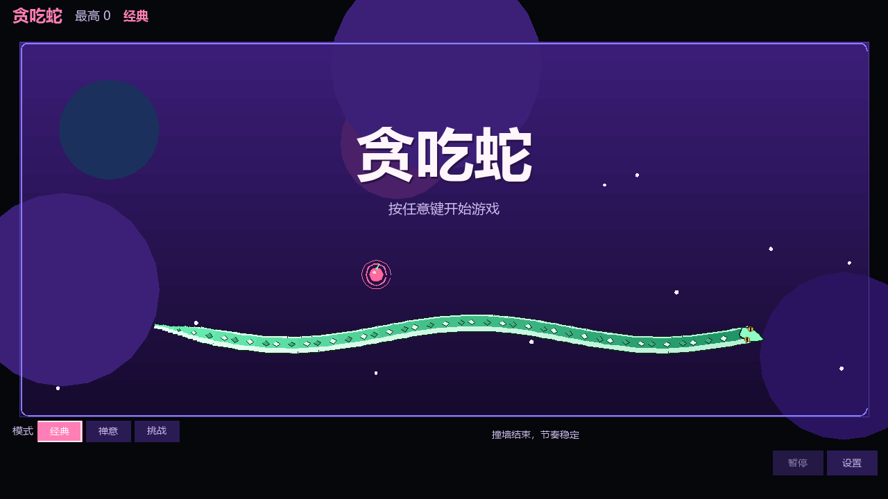
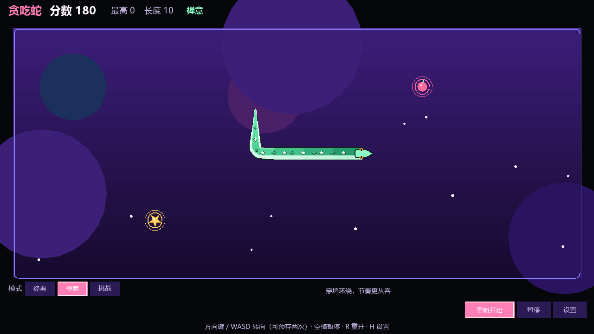
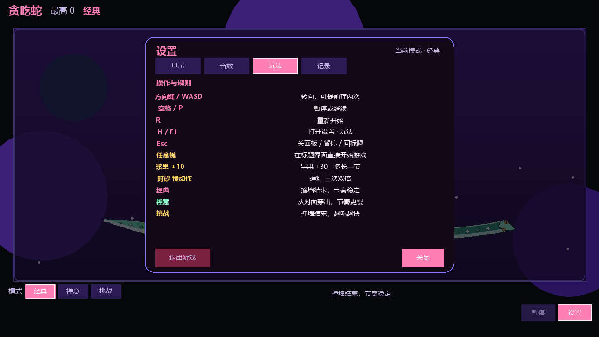
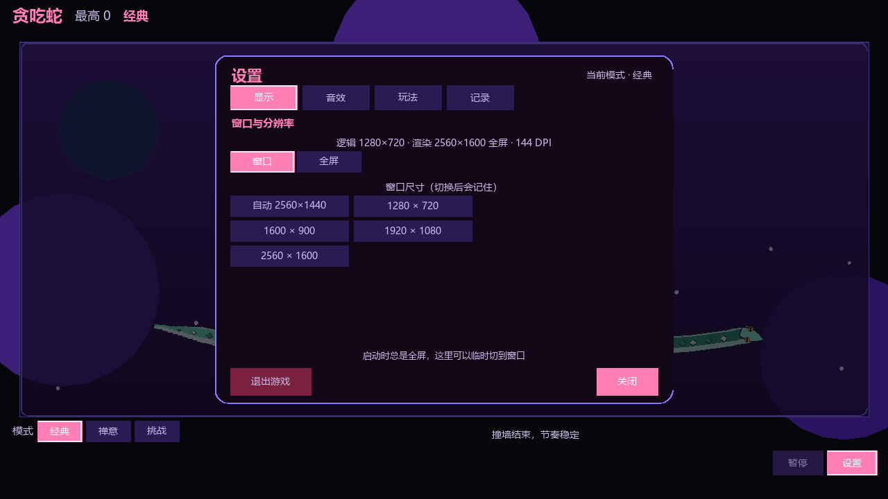

# 贪吃蛇

中文桌面贪吃蛇游戏，使用 Cocos Creator 3.8.6 制作。当前 Windows 发布版：**1.0.8**。有三种玩法、四种皮肤、特殊果实、音效和本地记录。



> 截图展示基础界面。选择其他皮肤后，标题蛇和对局中的蛇会随之改变。

## 下载与安装

从 [最新发布页面](https://github.com/Becauseofus/-snack-/releases/latest) 下载 Windows 64 位版本：

| 文件 | 用途 |
| --- | --- |
| `Snake-cocos-Setup-win64.exe` | 安装向导，可选择安装位置并创建快捷方式 |
| `Snake-cocos-win64.zip` | 免安装版，解压后运行 `Snake.exe` |

更新前请关闭游戏。若安全软件提示安装程序覆盖 DLL，请核对安装包来源及目标路径后再决定是否允许。

## 怎么玩

标题界面按普通按键或点击开始按钮进入游戏。用方向键或 WASD 控制蛇，吃果实增长并得分；经典和挑战模式撞墙或撞到自己会结束。可以提前输入最多两次转向，蛇会在下一格依次执行。标题界面的 F1–F12、Win 和修饰键不会触发开局。



### 三种模式

| 模式 | 规则 |
| --- | --- |
| 经典 | 撞墙结束，节奏稳定 |
| 禅意 | 穿过边界会从另一侧出现；撞到自己仍会结束，节奏较慢 |
| 挑战 | 撞墙结束；吃得越多移动越快，特殊果更常出现 |

对局中切换模式会在下一局生效。蛇走进本步即将空出来的尾巴格时不会误判为碰撞。

### 果实与得分

| 果实 | 效果 |
| --- | --- |
| 浆果 | 得 10 分，蛇增长 |
| 星果 | 得 30 分，并额外增长一节 |
| 时砂 | 暂时减慢移动，约持续 4.5 秒 |
| 莲灯 | 接下来三次得分翻倍 |

特殊果实有时限，临近消失时会闪烁。最高分、各模式记录和最近十局结果会保存在本机。

### 操作

| 按键 | 作用 |
| --- | --- |
| 方向键 / WASD | 转向，最多预存两次 |
| 空格 / P | 暂停或继续 |
| R | 重新开始 |
| Enter | 开始、继续或再来一局 |
| H / F1 | 在游戏中打开玩法说明 |
| N | 开关音效 |
| F11 | 切换窗口与全屏 |
| Esc | 关闭设置，或返回标题 |

手机和触屏上也可以滑动转向。



## 皮肤

点击“皮肤”，在名称右侧查看预览并选择：

- **经典青蛇**：默认的连续蛇身造型。
- **金鳞祥龙**：绿色鳞片与金色装饰。
- **霓光机械蛇**：银蓝色机身，头部屏幕会周期闪烁。
- **草莓糖果蛇**：粉色糖果与奶油条纹。

选择会自动保存，标题界面与对局同步使用所选皮肤。

## 显示、音效与存档

“设置”里可以调整窗口或全屏显示、音效开关，并查看玩法与历史记录。Windows 版音效使用随游戏打包的 WAV 文件，播放设备由 Windows 决定。存档使用 Cocos 的本地存储，保留分数、模式、显示设置和皮肤选择。



## 源码与构建

正式发布版位于 [Cocos Creator 工程](cocos/)，场景文件是 `cocos/assets/game.scene`。[工程说明](cocos/README.md)介绍本机预览与 Windows 构建。推送 `cocos-v*` 标签会触发 GitHub Actions 构建，并在 Releases 上传安装包和免安装版。

仓库根目录的 `snake_gui.py` 是早期 Python 版，可用 `python snake_gui.py` 运行；它与当前 Cocos 版的界面和功能不同。

运行 Cocos 逻辑与界面布局测试：

```bash
node --import ./test-loader.mjs --test cocos/tests/*.test.ts
```

[贡献者说明](CONTRIBUTORS.md)
