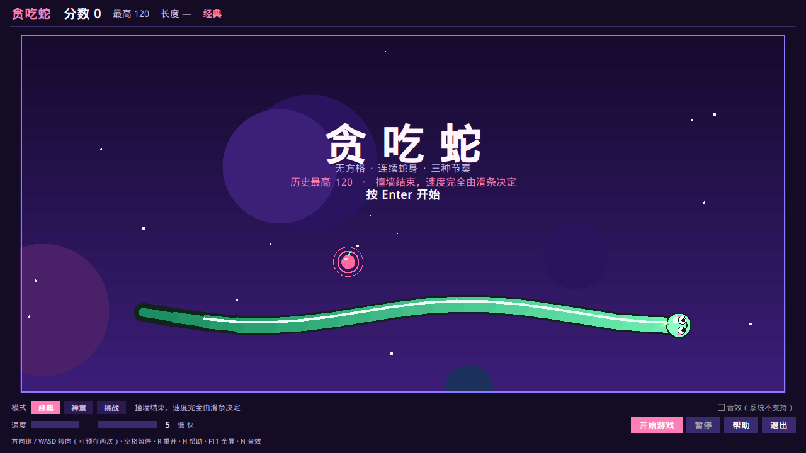
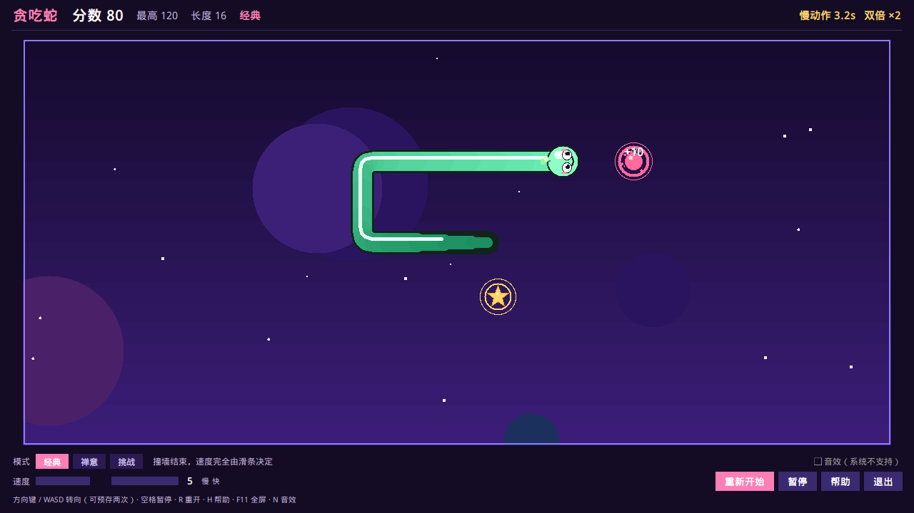
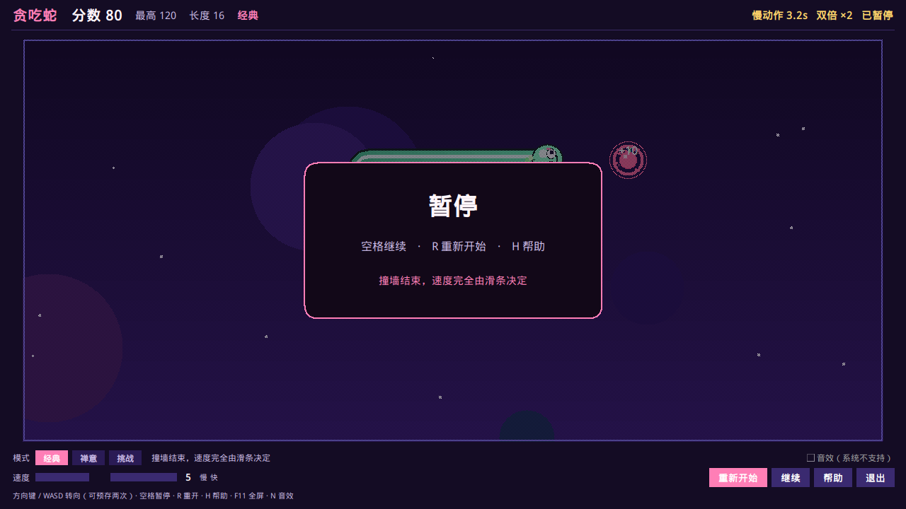
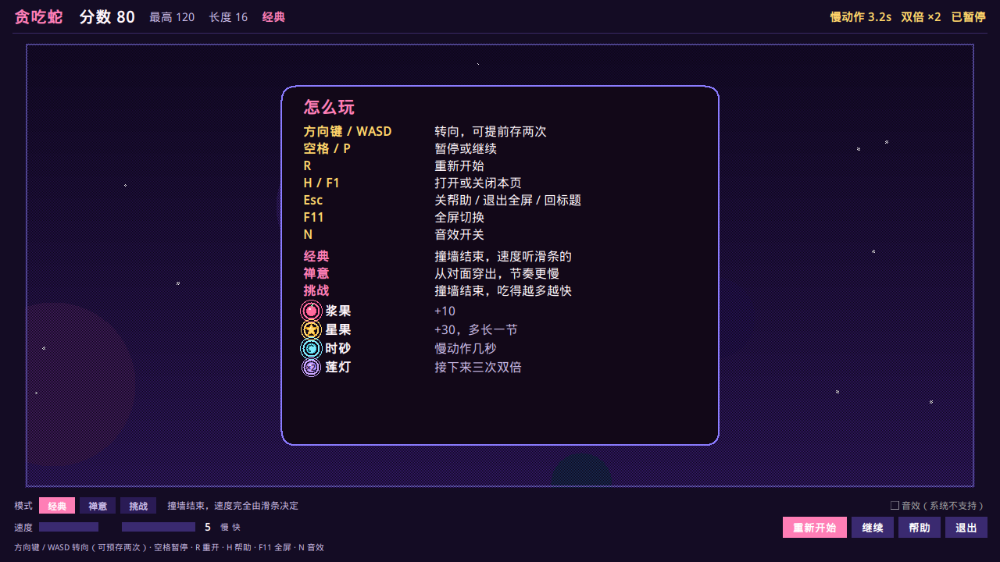
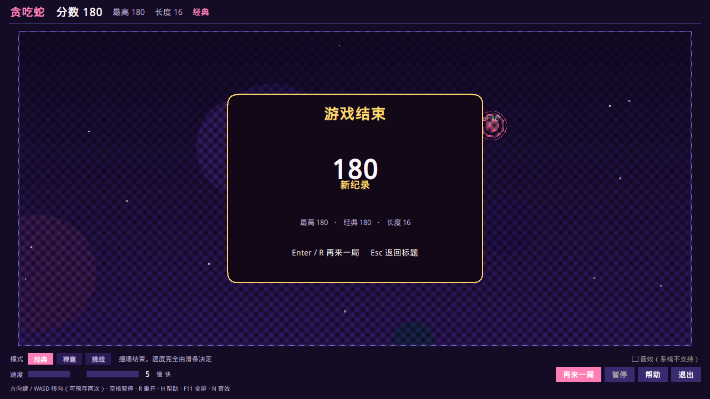

# 贪吃蛇

动漫风桌面贪吃蛇。场地没有格子，蛇是一条连续的身子，而不是一截一截的色块。窗口可以普通、无边框或全屏，在 Windows 上仍会留在任务栏里。



## 运行

```bash
python snake_gui.py
```

需要 Python 3.9+，以及标准库里的 `tkinter`。Windows 官方安装包已经带了；Ubuntu / Debian 需要 `python3-tk`。游戏本身没有第三方依赖。

音效是程序里合成的短音，只在 Windows 上通过 `winsound` 播放。没有音频文件。其他系统里音效开关会标成「系统不支持」，游戏照常运行。

设置写在：

- Windows：`%APPDATA%\SnakeGame\settings.json`
- 其他系统：`~/.config/SnakeGame/settings.json`

## 操作

| 按键 | 作用 |
| --- | --- |
| 方向键 / WASD | 转向。可以提前存两次，用来走直角 |
| 空格 / P | 暂停或继续。标题和结算界面上也会开始下一局 |
| R | 重新开始 |
| H / F1 | 操作说明 |
| Esc | 先关说明；在全屏或无边框时回到窗口；否则回标题 |
| F11 | 全屏切换 |
| N | 开关音效（仅 Windows 有声音） |
| Enter | 开始、继续，或再来一局 |

底栏有速度滑条（1 慢，10 快）、模式、开始 / 暂停 / 帮助 / 退出。设置菜单里可以改分辨率和显示模式，也可以看最近十局。

## 模式

- **经典**：撞墙结束。速度只由滑条决定。
- **禅意**：从对面穿出，基础节奏更慢。撞到自己仍然结束。
- **挑战**：撞墙结束，吃得越多越快，特殊果更常见。

对局中切换模式会在下一局生效。

## 果实

场上一直有一颗浆果。吃掉之后有机会再出现一颗会过期的特殊果，最后两秒会闪。

| 果实 | 效果 |
| --- | --- |
| 浆果 | +10 |
| 星果 | +30，并且多长一节 |
| 时砂 | 慢动作约 4.5 秒 |
| 莲灯 | 接下来三次吃到的分数双倍 |

莲灯的倍率会乘在当时的得分上。挑战模式里，时砂仍能把节奏拉回来一截。



暂停、说明和结算都是场地上的卡片，底栏不会被盖住。







## 窗口

分辨率指的是窗口外框。顶栏和底栏先占掉自己的高度，场地再放进剩下的区域，所以 720p、1080p、1440p、4K 这些档位都不会把按钮挤出屏幕。比当前屏幕大的档位会藏起来。

- **窗口**：按所选分辨率居中，不超出工作区（任务栏以外的区域）。
- **无边框**：铺满工作区，任务栏还在。用的是 Win32 窗口样式加 `WS_EX_APPWINDOW`，不是 `overrideredirect`，否则任务栏按钮会消失。
- **全屏**：覆盖整个屏幕。Esc 回到窗口。

高 DPI 下进程会设成 Per-Monitor DPI Aware，尺寸按物理像素算。

## 打包 Windows 安装包

在 Windows 上：

```bat
python -m pip install -r requirements.txt
python build_installer.py
```

也可以双击 `build_installer.bat`。`python build_installer.py --dry-run` 只打印 PyInstaller 命令。

产物：

- `dist/贪吃蛇.exe` — 游戏
- `dist/贪吃蛇安装程序.exe` — 安装向导

安装向导可以选择任意文件夹。默认是 `%LOCALAPPDATA%\Programs\SnakeGame`。它会复制游戏、建立开始菜单快捷方式，并可选桌面快捷方式。装到 Program Files 可能需要管理员权限。

这个打包脚本必须在 Windows 上跑，因为它生成的是 `.exe`。

## 测试

```bash
python -m unittest tests.test_snake
```

覆盖转向缓冲、穿墙、撞墙、吃果计分、倍率和慢动作、铺满场地，以及窗口里按钮是否还在画面内。

## 这一版改了什么

上一版已经有任务栏、DPI、分辨率、速度滑条、历史分数和无格子蛇身。那些都留着。手感和界面是这次改的重点：

- **转弯更跟手。** 逻辑仍在格子上，但画面按时间插值。转向最多预存两次，当前这一格走完才换方向，所以拐角是贴着路口转的，不会在半路跳开。
- **尾巴让路。** 不吃东西时，走进即将空出来的那一格不会把自己撞死。
- **三种模式和四种果实。** 每种果实有自己的颜色、光环和弹出的字。吃到和死亡都有一小团粒子；打破纪录时结算卡片用金色。
- **暂停、说明、结算** 都是单独的卡片。帮助页列出按键、模式和果实。
- **音效可关。** 没有外部素材，缺了播放接口就静音。
- **布局按真实控件高度计算**，而不是写死一块留白。无边框改为贴工作区，避免窗口伸进任务栏。

没有加联机、账号或关卡编辑器。单人这一局能玩完，就停在这里。
